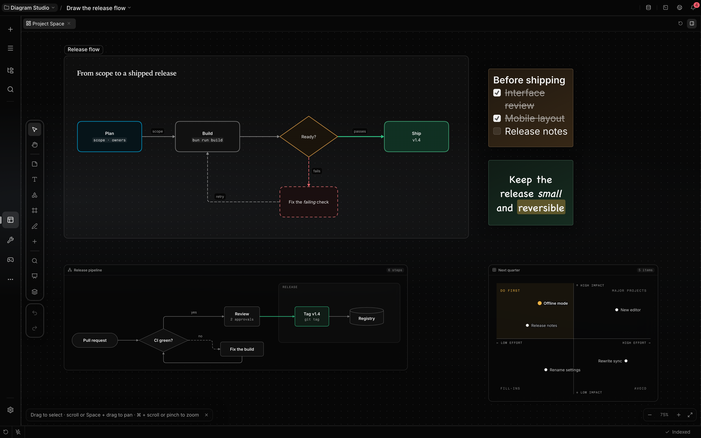

<p align="center">
  
</p>

<h1 align="center">Localix marketplace</h1>

<p align="center">
  <strong>Localix's own mini apps and plugins</strong>
</p>

<p align="center">
  Boards, games, data and developer tools that the agent works in beside you. Localix ships none of
  them built in: it trusts this repository and installs from it like from any other source.
</p>

<p align="center">
  <a href="#install">Install</a> ·
  <a href="#mini-apps">Mini apps</a> ·
  <a href="#plugins">Plugins</a> ·
  <a href="#build-your-own">Build your own</a>
</p>

<p align="center">
  <a href="mini-apps/project-space/docs/project-space.md">
    
  </a>
</p>

## Install

In **Localix**, open the Store: this marketplace is already there. **Mini apps** lists the apps,
**Plugins** the plugins. Install one and it is ready in your chats.

In **Claude Code**:

```bash
claude plugin marketplace add rsaryev/localix-marketplace
claude plugin install mini-app-authoring@localix
```

## Mini apps

Each one is a screen, a backend and tools the agent can call: you and the agent work on the same
board, table or game.

<table>
  <tr>
    <td width="33%" valign="top">
      <strong>Project Space</strong><br>
      One spatial board per project: notes, shapes, frames, diagrams and code, drawn by you or the agent.<br>
      <a href="mini-apps/project-space/docs/project-space.md">Project Space →</a>
    </td>
    <td width="33%" valign="top">
      <strong>Kanban board</strong><br>
      A task board per chat: epics, tasks, dependencies and blockers the agent keeps current.<br>
      <a href="mini-apps/kanban/docs/task-board.md">Kanban →</a>
    </td>
    <td width="33%" valign="top">
      <strong>Git</strong><br>
      Changes, conflicts, history, branches and review, with the agent in the same diff.<br>
      <a href="mini-apps/git-workspace/docs/source-control.md">Git →</a>
    </td>
  </tr>
  <tr>
    <td valign="top">
      <strong>Code Graph</strong><br>
      A navigable map of the project's code: files, symbols, imports and callers.<br>
      <a href="mini-apps/code-graph/docs/code-graph.md">Code Graph →</a>
    </td>
    <td valign="top">
      <strong>Database</strong><br>
      Browse schemas, run queries and hand the agent a table as context.<br>
      <a href="mini-apps/database/docs/database.md">Database →</a>
    </td>
    <td valign="top">
      <strong>API Client</strong><br>
      Build, save and send HTTP requests, with secrets kept in the vault.<br>
      <a href="mini-apps/api/docs/api.md">API Client →</a>
    </td>
  </tr>
  <tr>
    <td valign="top">
      <strong>DevOps</strong><br>
      Local containers and Kubernetes resources, logs included, in one workspace.<br>
      <a href="mini-apps/devops/docs/devops.md">DevOps →</a>
    </td>
    <td valign="top">
      <strong>Documents</strong><br>
      Read and create documents, spreadsheets, presentations and PDFs.<br>
      <a href="mini-apps/documents/docs/documents.md">Documents →</a>
    </td>
    <td valign="top">
      <strong>Reader</strong><br>
      A focused reader for EPUB, PDF, MOBI, FB2, comics and Markdown.<br>
      <a href="mini-apps/reader/docs/reader.md">Reader →</a>
    </td>
  </tr>
  <tr>
    <td valign="top">
      <strong>Trading</strong><br>
      Read-only market research: charts, indicators, order books and trades.<br>
      <a href="mini-apps/trading/docs/trading.md">Trading →</a>
    </td>
    <td valign="top">
      <strong>Resumes</strong><br>
      Structured resumes in a shared editor the agent edits section by section.<br>
      <a href="mini-apps/resume/docs/resume.md">Resumes →</a>
    </td>
    <td valign="top">
      <strong>Learning Studio</strong><br>
      Courses written as Markdown lessons, with quizzes and practice.<br>
      <a href="mini-apps/learning/README.md">Learning Studio →</a>
    </td>
  </tr>
  <tr>
    <td colspan="3" valign="top">
      <strong>Games against the agent</strong><br>
      Chess, Checkers, Battleship, Tic-Tac-Toe and Rock Paper Scissors against the agent or a
      decision model, plus 2048 and Snake to play yourself or watch a model play.<br>
      <a href="docs/games.md">Games →</a>
    </td>
  </tr>
</table>

## Plugins

Claude Code plugins, loaded by Localix as they are.

<table>
  <tr>
    <td width="50%" valign="top">
      <strong>Mini app authoring</strong><br>
      Describe a mini app and the agent creates, checks, installs and shares it:
      <code>/mini-app-authoring:create</code>, in Localix or Claude Code.<br>
      <a href="plugins/mini-app-authoring/README.md">Mini app authoring →</a>
    </td>
    <td width="50%" valign="top">
      <strong>Team</strong><br>
      Starter specialist agents: architect, backend, frontend, design and devops.<br>
      <a href="plugins/team/README.md">Team →</a>
    </td>
  </tr>
</table>

## Build your own

Every mini app here starts from the same template as yours: run `/mini-app-authoring:create` and
describe it. To publish your own marketplace, keep your apps in a repository like this one and add
it to the Localix Store as a source. See
[build with the agent](https://localix.ai/docs/extending--build-with-the-agent) and
[mini apps](https://localix.ai/docs/features--mini-apps).

## Working here

Bun only (`.bun-version`); `bun install` links the mini app kit. `bun run check` runs what CI runs:
the plugins (types, tests, `claude plugin validate`) and every mini app with `mini-app check`.
`bun run check <app>` checks one, and the pre-commit hook checks what is staged. `bun run pack`
builds the mini app marketplace into `dist/marketplace` (`mini-app-marketplace.json` and each app's
archive and media); each `v*` tag releases it, signed.

[Mini apps](mini-apps/README.md) and [plugins](plugins/README.md) describe how to add one. This
repository is released under the [MIT License](LICENSE).
