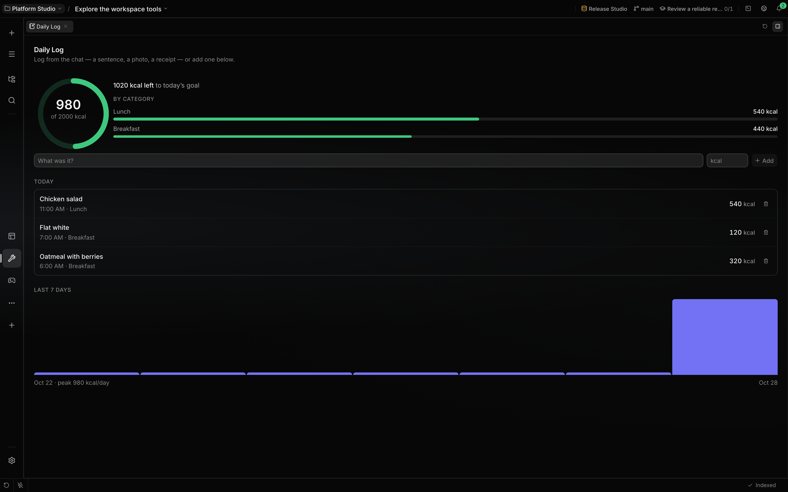

# Localix marketplace

Localix's own Claude Code plugins and mini apps. Localix ships none of them: it trusts this
repository and installs from it like from any other source.

- **[Plugins](plugins/README.md)** — `mini-app-authoring` (create, check, install and share mini
  apps) and `team` (starter specialist agents), listed in
  [`.claude-plugin/marketplace.json`](.claude-plugin/marketplace.json). Localix adds this
  marketplace on first start; install them from the Store (**Plugins**). In Claude Code:
  `claude plugin marketplace add rsaryev/localix-marketplace`.
- **[Mini apps](mini-apps/README.md)** — nineteen apps released together as one catalog on each tag
  `v*`; Localix's Store (**Mini apps**) reads it. Each app's guide is in its `docs/` folder;
  [games](docs/games.md) and the [recipes](docs/recipes/) span several.

## Working here

Bun only (`.bun-version`); `bun install` links the mini app kit. `bun run check` checks what CI
checks: the plugins (types, tests, `claude plugin validate`) and every mini app with
`mini-app check`. `bun run check <app>` checks one; the pre-commit hook checks what is staged.
`bun run pack` builds the catalog into `dist/catalog`.
